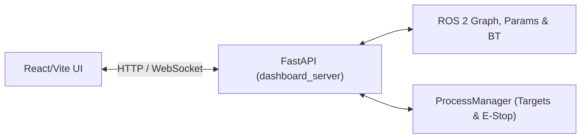

# ui-robot_dashboard

[](https://docs.ros.org/en/humble/) [](LICENSE) [](mailto:teamrobontu@gmail.com)

Web dashboard for the robot: process control (start/stop/restart configured
targets, e-stop), ROS2 parameter hotloading, a live graph browser (nodes,
topics, wiring, publish rate, message echo), a behavior tree visualizer with
live status and record/playback, and one-click launchers for
`foxglove_bridge`/`rviz2`. FastAPI backend + React/Vite frontend, packaged as
a single `ament_python` ROS2 node — `dashboard_server` (executable; ROS
graph identity `/ui/dashboard`) serves both the API and the built frontend
from one port.


---


## Architecture



## I. Requirements

- OS / middleware: Ubuntu 22.04, ROS 2 Humble
- Backend: `fastapi`, `uvicorn`, `pyzmq`, `pyyaml`, `pydantic` (isolated venv, see II)
- Frontend: Node 18+ (use `nvm`, see II)
- Hardware: none
- License: Apache-2.0

## II. Setup & Installation

```bash
git clone https://github.com/Team-Robo/public-ui-robot_dashboard.git ~/ros2_ws/src/ui-robot_dashboard

python3 -m venv ~/dashboard-env
source ~/dashboard-env/bin/activate
pip install -r ~/ros2_ws/src/ui-robot_dashboard/requirements.txt
deactivate

curl -o- https://raw.githubusercontent.com/nvm-sh/nvm/v0.39.7/install.sh | bash
source ~/.nvm/nvm.sh
nvm install 20 && nvm use 20

cd ~/ros2_ws/src/ui-robot_dashboard/frontend
npm install
npm run build

cd ~/ros2_ws
colcon build --packages-select robot_dashboard
```

## III. How to Run

zsh:
```zsh
source ~/ros2_ws/install/setup.zsh
ros2 launch robot_dashboard dashboard.launch.py
```

bash:
```bash
source /opt/ros/humble/setup.bash
source ~/ros2_ws/install/setup.bash
ros2 launch robot_dashboard dashboard.launch.py
```

Open `http://localhost:8080`. Don't mix `.bash`/`.zsh` sourcing.

- Backend-only changes: skip `npm run build`, just `colcon build` + relaunch.
- Fast frontend iteration: `npm run dev` in `frontend/` (separate terminal, backend already running on :8080).
- Config: `config/targets.yaml`, `config/behavior_trees.yaml` — these are
  **templates only** (see "Adding a new target / new BT" below); editing
  them and rebuilding only matters for seeding a fresh machine, not for
  changing what a machine that's already run once actually does.

### Adding a new target / new BT

Two independent things a running process can be, config-wise — a *target*
(anything the Control tab can start/stop/observe) and, separately, a *tree*
(a BT.CPP tree the BT tab can watch live via Groot2). Most BT executables
need both entries; a plain node only needs the first.

**The file that actually matters is not under `config/`.** `config/targets.yaml`
/ `config/behavior_trees.yaml` in this repo are seed templates - colcon
overwrites them on every build, so the *running* server never reads them
after the first launch. The real, live copies are `~/.dashboard_targets.yaml`
/ `~/.dashboard_behavior_trees.yaml`, seeded from the template once and never
touched by colcon again. Edit these two ways:

1. **Through the UI (normal way):** Settings modal → Targets or Trees tab →
   "Paste or import target/tree YAML" → paste one entry (or several) → Apply
   → review → Save. This calls `PUT /api/config/*`, which writes the live
   YAML (via `ruamel.yaml`'s round-trip mode, so your hand-written comments
   in the file survive) and applies it **immediately, no restart** -
   `ProcessManager.reload_targets()` / `TreeRegistry.reload()` pick it up
   live.
2. **By hand:** edit `~/.dashboard_targets.yaml` / `~/.dashboard_behavior_trees.yaml`
   directly on the machine running the dashboard, then use the Settings
   modal's Save once (or restart) to trigger a reload. If you also want a
   fresh machine to seed correctly in the future, make the same edit to the
   template under `config/` and commit it - that file otherwise only matters
   at first-run seed time.

### Battery (header indicator + `battery_monitor`)

Settings → **Battery** holds all the hardcoded battery plumbing in one place:
the `sensor_msgs/BatteryState` topic the header indicator reads (default
`/battery_state`), the `hdas_msg/Bms` topic (`/hdas/bms`), where Galaxea's
`hdas_msg` is installed (`~/work/galaxea/install/hdas_msg`), `capital_mode`,
warn/critical %, and stale seconds. It is stored in `~/.dashboard_battery.yaml`
(seeded from `config/battery.yaml`) and applies live on Save.

With *Spawn battery monitor* on, the dashboard itself runs
`ros2 run battery_monitor battery_monitor` (an external `battery_monitor` ROS 2 package,
which must be built and sourced) with those values, putting the `hdas_msg`
python/lib dirs on its path, and restarts it when a setting it uses changes.
It is **not** a Control-tab target (its command line comes from Settings), so
an e-stop doesn't stop it. A failed start (usually `hdas_msg` not found) shows
the monitor's own output under the form. The header indicator is on by default but
stays hidden until the first reading arrives (so it never shows off the robot), and
goes grey, never green/red, when data later goes missing or stale. `GET /api/battery` returns the status,
`GET`/`PUT /api/battery/config` the settings.

**Target schema** (`TargetConfig`, one list item per process):

```yaml
- id: my_node                 # unique, required - other things (a tree's
                               # target_id) reference this by exact string
  label: My Node              # display name in the Control tab
  category: cognition         # free-form grouping, just for UI sectioning
  kind: run                   # "run" -> ros2 run <package> <executable>
                               # "launch" -> ros2 launch <package> <launch_file>
  package: my_package
  executable: my_node         # required if kind: run
  # launch_file: my.launch.py # required instead, if kind: launch
  args: []                    # extra CLI args, appended verbatim after
                               # --ros-args if you include it yourself
  env: {}                     # extra env vars for the child process, merged
                               # OVER the dashboard server's own environment
                               # (so it can override, e.g. GROQ_API_KEY) -
                               # PYTHONPATH is special-cased: prepended to
                               # the existing one, not replaced, so ROS2's
                               # own site-packages don't get dropped
  cwd: null                   # optional working directory (~-expanded)
  autostart: false            # start automatically when the dashboard boots
  ready_node_name: null       # optional fully-qualified ROS2 node name -
                               # if set, the target stays "starting" until
                               # this name actually appears on the graph,
                               # instead of reporting "running" the instant
                               # the process spawns
  ready_timeout_sec: 10.0
  estop_exempt: false         # true = survives e-stop (default: e-stop
                               # SIGKILLs it like everything else)
  flags: []                   # optional Control-tab checkboxes, each:
                               #   - name: gpu
                               #     label: Use GPU
                               #     arg: "-p use_gpu:=true"
                               # a checked flag's arg is appended AFTER your
                               # base args at start time - ROS2's --ros-args
                               # -p parsing is last-wins, so a flag can
                               # cleanly override something your base args
                               # already set
```

**Tree schema** (`TreeConfig`, one list item per BT.CPP tree the BT tab can
watch):

```yaml
- id: my_tree                 # unique, required
  label: My Tree              # display name in the BT tab
  package: my_bt_package       # where tree_file lives (share/<package>/)
  tree_file: trees/my_tree.xml
  target_id: my_node           # MUST exactly match a target's `id` above -
                                # plain string cross-reference, not
                                # validated - a typo here just means the BT
                                # tab can't correlate "is this tree's
                                # process actually running," it won't error
  groot2_port: 1670             # MUST exactly match whatever port the
                                # executable itself actually binds via
                                # BT::Groot2Publisher - these are two
                                # independently hardcoded numbers with
                                # nothing keeping them in sync automatically;
                                # if they drift the BT tab gets a 409 "no
                                # reply from Groot2Publisher" even while the
                                # process is genuinely running (bit us once
                                # in cog-behaviour_tree - see its README's
                                # "Lifecycle" note)
  mission_control: false        # optional - true adds a Run mission /
                                # Next step / Cancel bar above the graph
                                # (MissionControls.tsx). Calls hri_bt_main's
                                # /behaviour_tree/{run,cancel}_mission and
                                # /behaviour_tree/demo/{continue,current_step,
                                # get_dialogue} (Trigger services), and shows
                                # the robot's memory (guest name/drink) and
                                # the conversation log - only meaningful for
                                # hri_bt_main trees
```

**Code-side requirement, not config**: the BT tab is a pure *viewer* - it
connects to a live `Groot2Publisher` ZMQ feed, it doesn't inject Groot2
publishing into your binary. Your `main()` has to actually construct one
against the tree (`BT::Groot2Publisher publisher(tree, port);`) on a
port that matches the tree config above, and the tree XML needs
`BTCPP_format="4"`. See external BehaviorTree.CPP packages's `hri_bt_main.cpp` /
`bt_main.cpp` for the pattern - if an executable already does this,
adding it here is genuinely config-only, no code changes.

### Auth

```bash
echo "your-passcode-here" > ~/.dashboard_passcode
```

No passcode = no auth. `passcode:=<something>` on the launch command works too, one-off.

### Running on the real robot (remote access)

The model: the backend (`dashboard_server` - FastAPI + rclpy) runs **on the
robot itself**, in the same ROS2 graph as everything else, so it has local
process/graph access with no cross-machine ROS2 discovery to configure.
You connect to it **from a separate device** (laptop, phone) over the LAN -
that device needs nothing but a browser. No ROS2 install, no `colcon`, no
Node, no cloned repo on the client side at all; the robot serves the whole
frontend as static files, same as any web app.

**On the robot:**
```bash
cd ~/ros2_ws
colcon build --packages-select robot_dashboard   # frontend/dist must already exist -
                                            # see II. Setup & Installation for
                                            # `npm run build`, only needed once
                                            # per frontend change, not per boot

# Set this before exposing the dashboard beyond localhost - see Auth above.
# Skipping this means anyone on the LAN gets an unauthenticated e-stop button.
echo "your-passcode-here" > ~/.dashboard_passcode

source /opt/ros/humble/setup.bash
source ~/ros2_ws/install/setup.bash
ros2 launch robot_dashboard dashboard.launch.py   # host defaults to 0.0.0.0 already -
                                             # listens on every interface, not
                                             # just localhost, nothing extra needed

sudo ufw allow 8080/tcp   # only if ufw is active - most bare robot images don't have it on
hostname -I                # note the robot's LAN IP, you'll need it next
```

**On your device (laptop/phone, same LAN):** open `http://<robot IP>:8080`,
enter the passcode. That's the entire client-side setup - nothing to
install, nothing to build, nothing to source.

### WSL2 dev box (local testing, not the robot)

Different scenario from the above - this is for reaching a dashboard running
in *your own* WSL2 dev environment (e.g. testing from your phone without a
real robot), which needs Windows-side port forwarding since WSL2 isn't
directly reachable on the LAN the way native Linux is:
```powershell
wsl hostname -I
netsh interface portproxy add v4tov4 listenport=8080 listenaddress=0.0.0.0 connectport=8080 connectaddress=<that IP>
New-NetFirewallRule -DisplayName "WSL2 Dashboard" -Direction Inbound -LocalPort 8080 -Protocol TCP -Action Allow
```
Browse to `http://<Windows Wi-Fi IP>:8080`. Redo the `netsh` line after `wsl --shutdown` (IP changes).

### Remote viz on your own machine (Foxglove/RViz2)

Foxglove Studio/Lichtblick on your own laptop, pointed at `ws://<robot IP>:8765` - works the same as the dashboard itself, just needs `sudo ufw allow 8765/tcp` too if `ufw` is active.

RViz2 natively on your own laptop: no port to open, just match `ROS_DOMAIN_ID` (currently unset on the robot = `0`):
```bash
export ROS_DOMAIN_ID=0
```

## IV. Repository Structure

```
ui-robot_dashboard/               ← this repo, ROS package name is robot_dashboard
├── package.xml / setup.py / setup.cfg / resource/robot_dashboard
├── config/
│   ├── targets.yaml            # process supervisor - TEMPLATE only, seeds
│   │                           # ~/.dashboard_targets.yaml on first run
│   ├── behavior_trees.yaml     # which BT.CPP trees exist - also a template,
│   │                            # seeds ~/.dashboard_behavior_trees.yaml
│   └── battery.yaml            # battery settings template -> ~/.dashboard_battery.yaml
├── launch/dashboard.launch.py  # injects dashboard-env onto PYTHONPATH
├── dashboard/                  # backend (FastAPI + rclpy)
│   ├── main.py                 # entry point - rclpy executor thread + uvicorn
│   ├── ros_bridge.py           # DashboardRosNode - graph introspection, service calls
│   ├── estop.py                # /estop publish + hard-stop every target except estop_exempt
│   ├── config_store.py         # ~/.dashboard_*.yaml - the LIVE, GUI-editable
│   │                           # config, deliberately outside anything colcon
│   │                           # manages (see V. below)
│   ├── battery.py              # Settings -> Battery: config, spawns battery_monitor,
│   │                           # latest BatteryState for the header indicator
│   ├── config_routes.py        # Settings modal's GET/PUT API - comment-
│   │                           # preserving writes, applies live, no restart
│   ├── supervisor/             # process lifecycle for targets.yaml entries
│   ├── params/                 # live ROS2 parameter get/set (rcl_interfaces)
│   ├── graph/                  # node/topic/service/action discovery, hz/echo
│   │                           # (topic_watcher.py, ros2_hz_probe.py), fake-publish scripting
│   │                           # (fake_publisher.py, schema.py) - scripts are
│   │                           # signallang, github.com/KhiemGOM/signallang
│   ├── bt/                     # static_tree.py (XML parse), groot2_client.py (ZMQ)
│   └── debug/                  # harness.py - synthetic ROS2 graph (topics/
│                                # services/action/params) for exercising the
│                                # dashboard's own features, not robot behavior -
│                                # see config/targets.yaml's "debug" category
└── frontend/                   # React + Vite + TS, NOT an ament package
    └── src/
        ├── App.tsx             # tab shell + persistent e-stop header
        ├── tabs/                # ControlTab, ParamsTab, GraphTab, BehaviorTreeTab,
        │                        # VisualizationTab, HelpTab
        ├── btLayout.ts          # BT reachability/staleness/tick-order + record/playback
        ├── namespaceTree.ts     # shared tree/search infra (Params + Graph tabs)
        └── api.ts               # REST/WS client
```

## V. Technical Explanation

- **rclpy + FastAPI/uvicorn coexistence** (`main.py`): a `MultiThreadedExecutor`
  is spun in a background daemon thread; uvicorn owns the main thread's
  asyncio loop. Every route handler wraps blocking rclpy/subprocess calls in
  `asyncio.to_thread` — never call `rclpy.spin_until_future_complete` here,
  the node is already being spun elsewhere.
- **Process supervisor** (`supervisor/`): `ros2 run`/`ros2 launch` wrapped in
  a process group (`start_new_session=True`) so `ros2 launch`'s multi-process
  fan-out gets killed cleanly on stop, not orphaned. Escalates
  SIGINT→SIGTERM→SIGKILL with a grace period; e-stop skips straight to
  SIGKILL. Targets can declare optional `flags` (checkboxes in Control/
  Visualization tabs) — a flag's `arg` is appended to the launch/run command
  only when checked at start time, and disables itself once the target is
  running (flags only make sense pre-launch).
- **Config-GUI live config** (`config_store.py`, `config_routes.py`, the
  Settings modal): `targets.yaml`/`behavior_trees.yaml` under `config/` are
  templates only - colcon happily overwrites them on every build, so they're
  never what the running server actually reads. The real, GUI-editable copy
  is `~/.dashboard_targets.yaml` / `~/.dashboard_behavior_trees.yaml`,
  seeded from the template on first run and never touched by colcon again -
  matches `~/.dashboard_passcode`'s own convention of real settings living
  outside anything the build system manages. Saves write through
  `ruamel.yaml`'s round-trip mode, mutating the existing parsed document
  in place rather than re-serializing from scratch, so a GUI edit doesn't
  wipe the file's own hand-written comments. Applies live -
  `ProcessManager.reload_targets()` / `TreeRegistry.reload()` - no restart:
  a target id that still exists gets its config swapped in place without
  disturbing its current running state, and a target that's RUNNING or
  STARTING is never removed even if its entry was deleted from the GUI
  (reported back as a skipped removal instead) - a config edit must never
  silently drop tracking of a live process.
- **Params** (`params/`): live get/set via the standard `rcl_interfaces`
  services every ROS2 node exposes natively — no custom per-node code
  needed. A `read_only=True` param returns a structured `{ok:false, reason}`
  on a failed set, not a 500.
- **Graph** (`graph/`): node/topic/service/client/action introspection via
  `get_node_names_and_namespaces()` etc. Actions use `rclpy.action`'s own
  `get_action_{server,client}_names_and_types_by_node()` - a real graph API,
  not pattern-matching the `_action/` naming convention - and the 5 raw
  services/topics an action is built from are filtered out of the plain
  lists so it shows up once, not 6 times. `topic_watcher.py` shares one real
  subscription per topic between however many browser tabs are watching its
  `hz`/`echo` (ref-counted), rather than one subscription per watcher.
  The Hz readout is `<ros2 topic hz> Hz (received <ours> Hz)`: the headline
  is the real `ros2 topic hz` CLI, run as a subprocess per watched topic
  (`ros2_hz_probe.py`: own process, raw subscription, so it is not affected by
  this backend's single executor dropping messages), and the bracket is this
  backend's own subscription (5 s sliding window) - a gap between them means
  the dashboard is missing messages the publisher is really sending. Matching
  the CLI also means its quirks: a cumulative average over up to 10000
  messages, so a one-off hiccup depresses the number for a while, and no
  value at all once the topic goes quiet (dropped after 5 s, not frozen).
  `GET /api/graph/topics/<t>/hz` returns `rate_hz`/`sample_count` (ours) plus
  `ros2_hz`/`ros2_window`/`ros2_error` (the CLI). Needs `ros2` on the
  backend's PATH; unit tests: `python3 -m unittest discover -s test -v`.
  Fake-publish (`fake_publisher.py`) drives a compiled
  [signallang](https://github.com/KhiemGOM/signallang) script's
  `ScriptRun.step()` off a real `rclpy` wall timer, retiming only when a
  tick's reported `hz` actually changes. `schema.py`'s `RosSchemaProvider`
  is the seam signallang's core is built around — real rosidl message
  reflection (`fields_at`/`default_at`/`type_at`) standing in for the
  test-double `DictSchemaProvider` signallang's own docs describe. For
  what a script can actually say — macros, timers, `Duration`, random
  distributions, `terop`, `wait`, `seed` — see that repo's README, not
  this one; the PublishPanel's own inline hint only covers the basics.
  For faking data through the dashboard generally — topic publish,
  service calls, action goals, the exact JSON a service/action request
  needs — see [`docs/fake-data/`](docs/fake-data/README.md).
- **Behavior Tree** (`bt/`, `frontend/src/btLayout.ts`): `static_tree.py`
  parses BT.CPP XML off disk (`SubTree` references resolved/inlined).
  `groot2_client.py` talks to a *running* tree's `Groot2Publisher` over
  ZMQ — **read the large comment block at the top of that file before
  touching it**, it documents a reverse-engineered wire protocol (multipart
  replies, an undocumented status-byte encoding) and a real trap in the data
  (a node's raw status byte reads identically whether it was genuinely
  re-ticked with the same result, or wasn't ticked at all this round and is
  just showing a frozen last-known value). That trap is fixed at the
  application level in `computeReachedThisTick()` (`btLayout.ts`) — using
  BT.CPP's own documented Sequence/Fallback short-circuit semantics to
  compute which nodes were structurally on the *current* tick's execution
  path, instead of comparing consecutive poll bytes (tried first, wrong: a
  healthily steady tree re-succeeding identically every tick faded out
  immediately, reading as "dying" when it was actually fine).
  `deriveLiveStates()` turns a raw status snapshot into reached/flash/stale
  per node — the single place both the live 1Hz poll and the Record/Playback
  replay go through, so the two can't drift into meaning different things.
  Record/Playback polls at 20Hz into a buffer, then collapses it down to
  transition-only steps at stop time (dropping repeated identical polls) so
  stepping through a recording shows "what changed," not "every poll." Each
  step also gets a *derived* (not measured) per-node tick-order badge via
  `walkExecutionOrder()` — BT.CPP ticks children in declaration order and
  Sequence/Fallback's short-circuit rule is exactly what decides which
  children get ticked at all, so that order is reconstructable after the
  fact from structure + resulting statuses alone; it cannot recover real
  wall-clock/microsecond timing, since the wire protocol carries none.

## VI. References

- FastAPI: https://fastapi.tiangolo.com/
- BehaviorTree.CPP: https://www.behaviortree.dev/
- BehaviorTree.ROS2: https://github.com/BehaviorTree/BehaviorTree.ROS2
- Foxglove Bridge: https://github.com/foxglove/ros-foxglove-bridge
- RViz2/WSLg zero-size-window bug (Qt/Wayland) — not universal, seen and
  fixed on one dev's machine (`/mnt/shared_memory` missing broke Weston's
  shared-memory frame buffer path) - see the dashboard's Help tab for the
  fix commands if you hit it
- `config/targets.yaml` — venv/PYTHONPATH injection convention this
  package follows

---

## VII. Known limitations / TODO

- **Auth is opt-in, off by default.** See "Auth" under How to Run - a
  passcode must be explicitly set via the `passcode:=` launch arg before
  this is safe to expose beyond localhost. Still a single shared passcode,
  not real per-user accounts - fine for a small team's LAN tool, not
  something to expose to the open internet.
- **BT Record/Playback cannot show sub-tick internal traversal order.**
  `bt_main.cpp` ticks the whole tree (root down to leaves and back) in
  well under a millisecond - the ZMQ STATUS feed only ever reports "the
  tree's state right now," not a trace of the order nodes were visited
  within one tick. Recording at 20Hz (`RECORD_POLL_INTERVAL_MS` in
  `btLayout.ts`, 2x the tree's own 10Hz tick rate) catches every distinct
  tick-to-tick state the tree actually passed through, which is what
  playback steps/scrubs through - it does not and cannot reconstruct what
  happened *inside* a single tick. If a future tree needs that level of
  detail, it requires instrumenting BT.CPP itself (e.g. a custom
  `StatusChangeLogger` writing structured events), not more polling.
- **Sensor-input staleness isn't detected.** A BT condition node like
  `PersonDetected` can keep reporting `SUCCESS` on frozen data forever if
  its upstream ROS2 topic stops publishing - BT.CPP ticks the tree
  unconditionally regardless of whether fresh sensor data arrived, and the
  dashboard's reachability tracking only knows about BT control-flow
  freshness, not sensor freshness (those are different signals). The
  correct fix lives in the BT node itself (e.g. `PoseToBlackboard` in
  external BehaviorTree.CPP packages), not the dashboard - `BT::RosTopicSubNode`'s own
  `last_msg == nullptr` signal on stale ticks is already available and
  currently unused. Deliberately deferred, not forgotten.
- **Embedded Lichtblick (Phase C) isn't built yet** - see the original
  implementation plan (vendored web bundle, mounted conditionally). The
  Visualization tab covers the low-risk slice instead: 1-click start/stop
  for `foxglove_bridge`/`rviz2` (both plain `config/targets.yaml` entries,
  same supervisor the Control tab uses) plus a verified step-by-step
  walkthrough for connecting an external client. RViz2 may or may not hit a
  WSLg zero-size-window bug (Qt/Wayland) depending on your setup - not
  universal, see the Help tab if `rviz2` renders empty for you.
- ~~**Node "running" state has no readiness probe**~~ Fixed, opt-in: a
  target can declare `ready_node_name` in `targets.yaml` (a fully-qualified
  ROS2 node name) and the supervisor holds it at `starting` - polling the
  ROS graph - until that name actually appears, instead of reporting
  `running` the instant the process spawns. Still per-target and explicit,
  not automatic: there's no reliable way to infer a node's real registered
  name from its executable/package alone (remapping, multi-node launch
  files), so a target that omits `ready_node_name` keeps the old
  immediate-`running` behavior unchanged. `person_pose_python` is wired up as
  a real example (`/perception/person_pose_python`, verified against
  `person_pose_python.py` directly, not guessed).

---

## Contributors

- **Khiem Nguyen** (`@KhiemGOM`)
- **Dun Yan Ong** (`@dunyanong`)
- **Chen Ting-Ju (Cynthia)** (`@cynthia-ccluna`)

Maintained by **Nanyang Technological University Team Robo** (`teamrobontu@gmail.com`).

## License

Licensed under the [Apache License 2.0](LICENSE).
