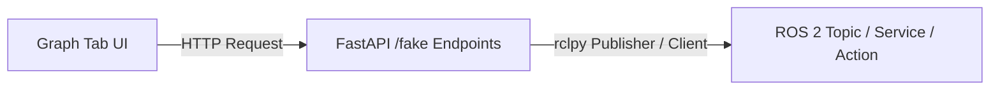

# Faking ROS2 data through the dashboard

  

> **Docs for [`public-ui-robot_dashboard`](../../README.md):** How the Graph tab fakes ROS 2 topics, services, and actions.

The dashboard's Graph tab can fake all three kinds of ROS2 interaction —
publish a topic, call a service, send an action goal — without writing a
throwaway `rclpy` script. This is the intended way to exercise a subscriber,
a service server, or an action server under test: **use these, don't write
a bespoke Python script.**

All three live under Graph tab → pick a node/topic/service/action → the
"advanced: send goals" toggle exposes the sending UI (off by default, since
it's a real publish/call/goal against whatever's actually running).

| Interaction | Guide | What you write |
| --- | --- | --- |
| Topic publish (fake sensor feed, mock a message for a subscriber under test) | [topic-publish-signallang.md](topic-publish-signallang.md) | A [signallang](https://github.com/KhiemGOM/signallang) script |
| Service call | [service-calls.md](service-calls.md) | A raw JSON object (the request fields) |
| Action goal | [action-goals.md](action-goals.md) | A raw JSON object (the goal fields), plus optional cancel |

Services and actions both use the *same* JSON→message mechanism under the
hood (`rosidl_runtime_py.set_message.set_message_fields` — a straight
recursive dict-to-typed-message mapping, no special syntax), so
[service-calls.md](service-calls.md) covers that mapping in detail and
[action-goals.md](action-goals.md) just points back to it rather than
repeating it.

Topic publishing is the odd one out — it's time-varying (a fake sensor feed
ticks continuously, not one-shot), so it goes through a small scripting
language (signallang) instead of a single static JSON blob. See
[topic-publish-signallang.md](topic-publish-signallang.md) for the
dashboard-specific integration (how to name a script's target topic/type,
`.signal` import/export); for the language itself (variables, timers,
`Duration`, random distributions, macros) see
[signallang's own README](https://github.com/KhiemGOM/signallang) — this
repo doesn't duplicate that.

## Architecture

## Where the code lives

- `dashboard/graph/routes.py` — all three endpoints (`fake_publish`,
  `services/{name}/call`, `actions/{name}/send_goal|cancel|stream`).
- `dashboard/graph/fake_publisher.py` — signallang script execution for
  topic publish.
- `dashboard/graph/action_client.py` — `ActionInvoker`, action goal
  send/cancel/feedback plumbing.
- `dashboard/ros_bridge.py` — `call_service_dynamic`, the service-call half
  of the JSON→message mapping.
- Frontend: `frontend/src/PublishPanel.tsx`/`PublishInstance.tsx` (topic),
  `frontend/src/ServicesTreeView.tsx` (service),
  `frontend/src/ActionsTreeView.tsx` (action), all wired into
  `frontend/src/tabs/GraphTab.tsx`.
